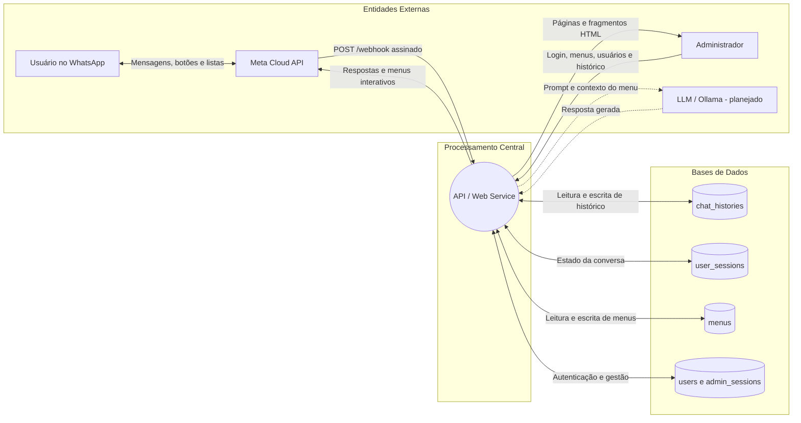
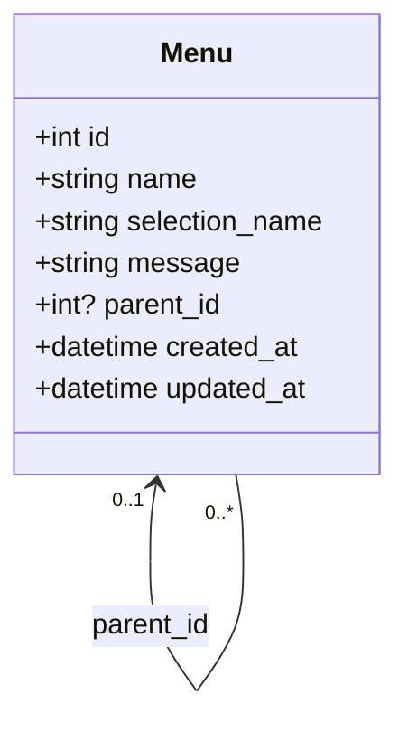
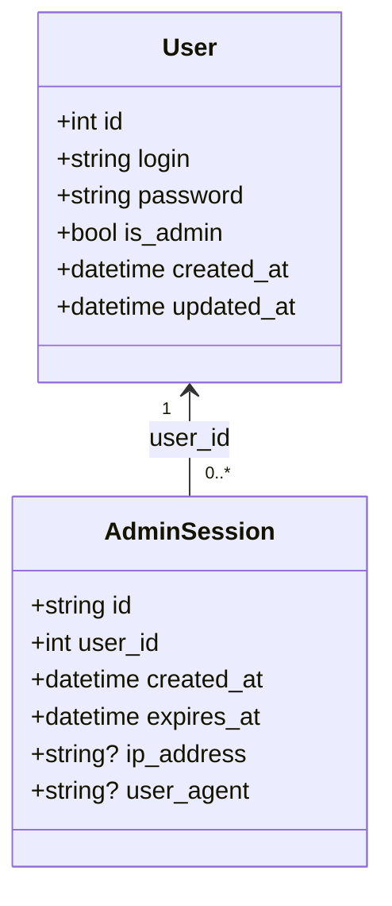
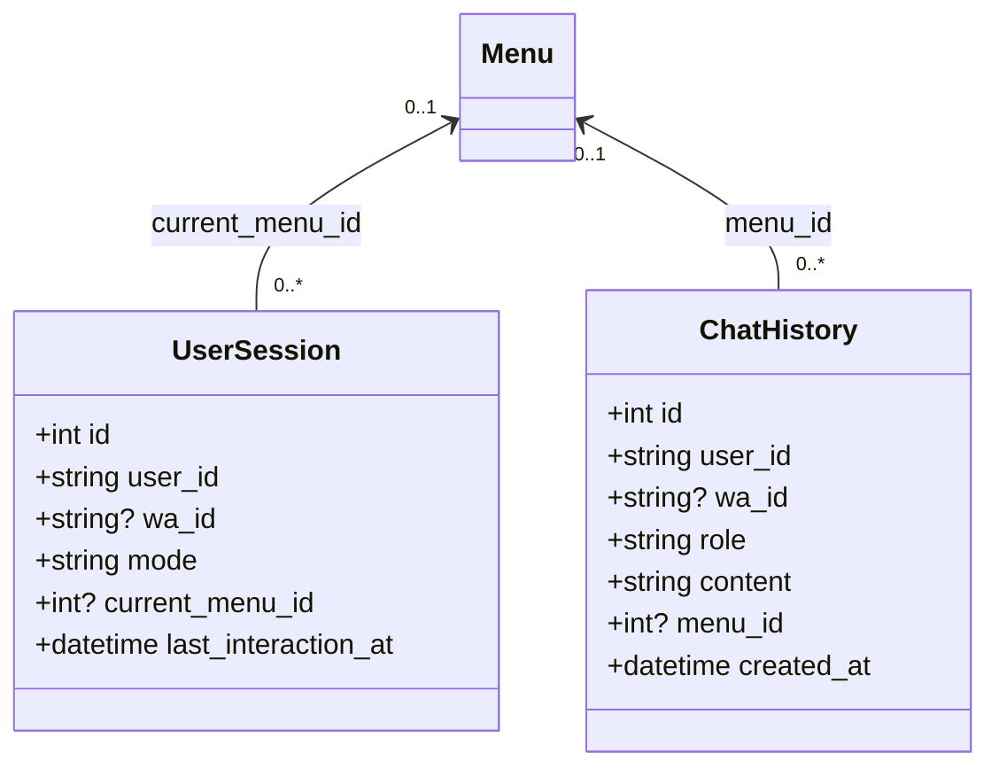

## Arquitetura - Overview

A aplicação é um chatbot de atendimento no WhatsApp que combina navegação estruturada por menus hierárquicos e, futuramente, atendimento conversacional alimentado por um modelo de linguagem (LLM).

O único canal de mensageria é o WhatsApp, pela WhatsApp Cloud API da Meta (biblioteca PyWa). O Telegram foi retirado do escopo. O painel administrativo web, protegido por autenticação, gerencia os menus e os usuários administradores e mostra o histórico das conversas. A integração com o provedor local de LLM (Ollama) ainda não está ligada: a opção "Fazer uma pergunta" responde com um aviso de indisponibilidade e devolve o menu principal. A hospedagem é projetada para nuvem, VPS ou infraestrutura auto-hospedada (self-hosted).

## Stack

- **Linguagem / Backend:** Python 3.12
- **Framework Web / API:** FastAPI
- **ORM:** SQLModel
- **Banco de Dados:** SQLite (modo WAL, chaves estrangeiras ligadas)
- **Frontend:** HTMX e Jinja2, com um único script (`app.js`) e uma folha de estilos (`style.css`) estáticos
- **Canal de Mensageria:** WhatsApp Cloud API, via PyWa
- **Provedor LLM (planejado):** Ollama (modelo de porte reduzido, com guardrails)

## Regras de Negócio e Funcionalidades

### 1. Atendimento e Navegação (Chatbot)

- **Identidade do usuário:** cada usuário é identificado pelo BSUID da Meta (`user_id`), que sempre existe. O telefone (`wa_id`) é opcional: usuários com nome de usuário do WhatsApp não têm telefone. As respostas vão para o telefone normalizado quando ele existe (número brasileiro de 12 dígitos recebe o 9º dígito) e, senão, para o BSUID. A regra do 9º dígito é uma decisão em aberto até o primeiro teste com um número real da Meta.
- **Menu raiz como contêiner:** existe um único menu sem pai. A `message` dele é o texto de boas-vindas e os filhos diretos são as opções, mais a opção fixa "Fazer uma pergunta". A raiz não aparece como opção de si mesma.
- **Navegação em menus:** ao selecionar um item, o bot envia a `message` do menu escolhido e lista os filhos imediatos, seguidos de "Voltar", que leva ao menu pai (a raiz, quando o menu está logo abaixo dela). Isso vale em qualquer profundidade; submenus não oferecem "Fazer uma pergunta" nem "Voltar ao início". O nome interno (`name`) nunca é enviado ao usuário; o texto do botão ou da linha é o `selection_name`.
- **Folhas:** um menu sem filhos envia a `message` seguida de "Deseja realizar outra consulta?", com os botões "Voltar" (ao pai) e "Voltar ao início" (à raiz), em qualquer profundidade. A raiz não tem botão de retorno.
- **Ordem das opções:** os filhos de cada menu são ordenados pelo nome interno (`name`), sem diferenciar maiúsculas, minúsculas e acentos, e comparando sequências de dígitos como números ("2 - Y" vem antes de "10 - X"); empates seguem o id. Para controlar a ordem no WhatsApp, numere o nome interno ("1 cursos", "2 secretaria"). As opções fixas ("Fazer uma pergunta", "Voltar") vêm depois dos menus.
- **Limites da Meta:** filhos mais "Voltar" em até 3 opções viram botões de resposta rápida; acima disso, uma lista interativa com no máximo 10 linhas, com os filhos na seção "Menu" e o "Voltar" sozinho na seção "Navegação" (na raiz, 9 menus mais "Fazer uma pergunta"). Por isso todo menu comporta no máximo 9 filhos. O cadastro de menus impede excedentes e o bot corta o que passar disso (reservando a linha de "Voltar"), com um aviso no log. Títulos de botão têm 20 caracteres, o de linha 24 e o corpo da mensagem 1024: o `selection_name` aceita no máximo 20 caracteres e a `message` no máximo 991 (1024 menos o texto "Deseja realizar outra consulta?" que as folhas acrescentam), contados depois de remover os espaços das pontas. As linhas de menu mostram só o `selection_name`, sem descrição (a única descrição é a fixa de "Fazer uma pergunta"), para que o nome interno nunca chegue ao usuário.
- **Sessão do usuário:** o estado (`mode`, menu atual, última interação) fica em `user_sessions`. Após 15 minutos sem atividade a sessão volta ao modo menu e o menu atual é limpo. Ao mostrar o menu raiz, o menu atual também é limpo.
- **Transição conversacional:** a opção "Fazer uma pergunta" e o modo conversacional responderão via LLM fundamentada nos menus. Enquanto o Ollama não está conectado, o usuário recebe "Nosso assistente está temporariamente indisponível. Escolha uma opção do menu:" com as opções da raiz.
- **Eventos do webhook:** cada evento (mensagem, clique em botão ou linha de lista) roda em uma única transação: sessão, mensagem recebida e resposta são gravadas juntas, no final, ou nenhuma delas é. As gravações só chegam ao SQLite no commit, depois do envio à Meta, para que o bloqueio de escrita não fique preso à chamada de rede. Falhas de um tratador viram uma linha de log mascarada e nunca derrubam o webhook.
- **Integridade do webhook:** cada evento precisa trazer a assinatura `X-Hub-Signature-256` calculada com o `APP_SECRET`; o desafio de verificação usa o `WA_VERIFY_TOKEN`. Logs mascaram telefone e BSUID.

### 2. Painel Administrativo (Frontend / Web Service)

- **Autenticação:** login e senha (Argon2id). O `admin` inicial é criado a partir de `ADMIN_INITIAL_PASSWORD` quando o banco não tem usuários. A sessão fica em `admin_sessions` (12 horas) e viaja em um cookie `HttpOnly` (`__Host-session` sobre HTTPS, `session` sobre HTTP). O login tem limite de 5 tentativas por minuto por IP e mostra "Usuário ou senha inválidos." ou a mensagem de excesso de tentativas na própria página.
- **Perfis:** administradores acessam Menus, Usuários e Histórico; usuários comuns acessam Menus e Histórico. Não é possível excluir a própria conta nem remover o último administrador. Trocar a senha de um usuário encerra as sessões dele.
- **CSRF:** o token, derivado por HMAC da sessão, segue no atributo `hx-headers` do `<body>` e é enviado em toda requisição HTMX que altera estado. `/login`, `/logout` e `/webhook` são isentos (o webhook é validado pela assinatura).
- **Política de conteúdo:** as páginas não têm script, manipulador de evento nem estilo embutidos, e o `Content-Security-Policy` não permite `'unsafe-inline'`. Todo o comportamento está em `static/app.js`.
- **Gestão de Menus (CRUD):** tela em duas colunas (lista à esquerda, formulário à direita). A lista e o seletor de "Menu Pai" mostram o menu raiz primeiro e os demais na ordem natural do `name`, a mesma regra das opções do WhatsApp. Regras: raiz única (checkbox "Definir como Menu Raiz"), sem ciclos, exclusão bloqueada para menus com submenus, nome, texto de seleção e mensagem obrigatórios (sem espaços nas pontas), no máximo 9 filhos por menu (raiz ou não), texto de seleção com até 20 caracteres e mensagem com até 991 ("{Campo} pode ter no máximo {N} caracteres.", status 422, formulário preenchido de novo). Os campos limitados têm `maxlength` e um contador "n/N" ao lado, atualizado enquanto se digita; o nome interno não tem limite.
- **Gestão de Usuários (CRUD):** mesma tela em duas colunas, restrita a administradores.
- **Histórico:** tabela paginada (50 linhas por página, da mais recente para a mais antiga) com ID, ID Usuário (telefone ou BSUID), Remetente, Conteúdo, Menu Acessado e Data/Hora (UTC).
- **Retorno de erros e confirmações:** erros de validação (400 e 422) aparecem dentro do formulário, com `role="alert"`; os demais (403, 404, 429, 5xx) aparecem em uma faixa de alerta no topo da página. Criar, atualizar e excluir um menu ou usuário mostra uma confirmação verde ("Menu criado com sucesso.", "Usuário excluído com sucesso." e as demais) no mesmo espaço dos erros, com `role="status"`; ela some quando outro card é carregado. O item ativo da lista acompanha o card exibido.

### 3. Persistência e Dados

- **Estrutura de menus:** relação recursiva (`Menu.parent_id`), com um único menu sem pai.
- **Sessões e mensagens:** `user_sessions` e `chat_histories` guardam o estado e o histórico. A exclusão de um menu limpa as referências (`ON DELETE SET NULL`) sem apagar histórico nem sessões.
- **Datas:** gravadas em UTC; o tipo `UTCDateTime` devolve sempre valores com fuso.

## Diagrama de Fluxo de Dados (DFD)

## Diagramas de Classes

Os nomes das entidades seguem o código (`src/models/`).

### Classe Menu

Árvore hierárquica de menus e mensagens estáticas. O menu sem pai é a raiz.

### Classes User e AdminSession

Credenciais e permissões de acesso ao painel, e as sessões web ativas.

`User.password` guarda o hash Argon2id, nunca a senha.

### Classes UserSession e ChatHistory

Estado da conversa de cada usuário do WhatsApp e o registro das mensagens trocadas.

`user_id` é o BSUID. `role` vale `user` (mensagem recebida) ou `bot` (resposta enviada). `mode` vale `menu` ou `conversational`.
